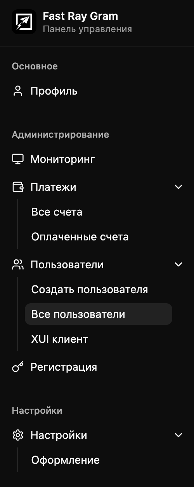
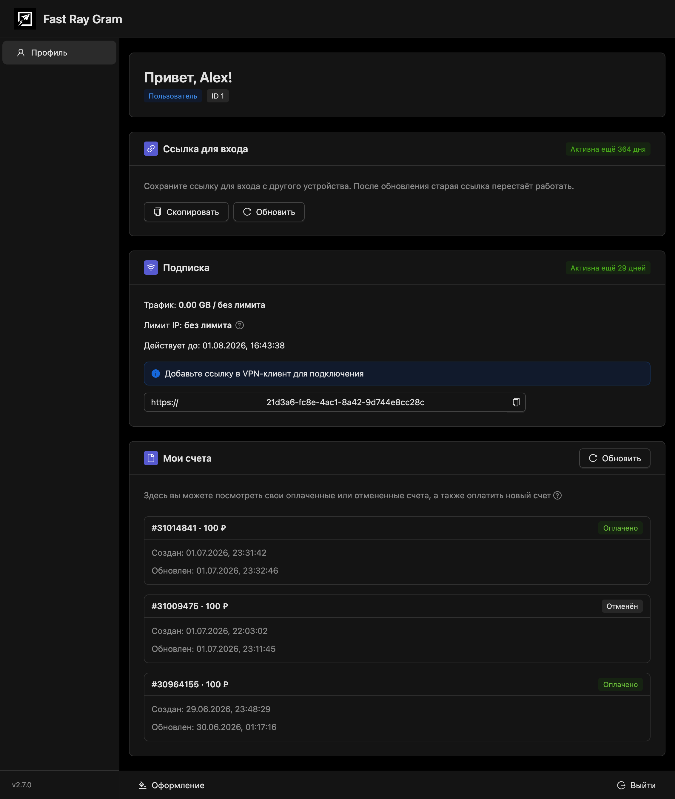

<p align="center">
  
</p>

<h1 align="center">Fast Ray Gram</h1>

<p align="center">
  Self-hosted кабинет и админка для VPN на <strong>3X-UI</strong>
</p>

<p align="center">
  <a href="LICENSE"></a>
  
  
</p>

## Features

- Личный кабинет: подписка, deep-link в VPN-клиенты, оплата, вход по ссылке
- Регистрация по одноразовому коду
- Админка: пользователи, XUI, счета, уведомления, мониторинг
- Платежи через хостинг-API (Aeza), воркер проверяет оплату и продлевает XUI

**Stack:** FastAPI · PostgreSQL · React · Docker

## Preview

| Admin | Profile |
|:---:|:---:|
|  |  |

## Quick start

**Need:** Docker Compose v2, панель 3X-UI, токен хостинга для платежей.

```bash
git clone <repository-url>
cd FastRayGram
cp .env.example .env
# смените секреты, укажите XUI и HOSTING
docker compose up -d --build
```

Откройте `http://<server>/` (порт `FRONTEND_PORT`, по умолчанию `80`).

```
Browser → nginx (frontend + /api) → FastAPI → PostgreSQL
                ↑
         invoice-worker
```

API снаружи только через nginx. Прямой `:8000` слушает `127.0.0.1`. Rate limit на `/api`: **20 r/s** и **300 r/m** с IP → `429` / страница `/too-many-requests`.

## Configuration

| Variable | Purpose |
|---|---|
| `APP__JWT_SECRET` | JWT |
| `APP__SUPERUSER_TOKEN` | суперпользователь + invoice-worker |
| `APP__HELP_URL` | кнопка «Помощь» |
| `XUI__URL` / `XUI__SUB_URL` / `XUI__API_KEY` | 3X-UI |
| `HOSTING__TOKEN` / `HOSTING__BASE_URL` | платежи |
| `PAYMENT__*` | цена дня, срок, валюта |
| `DB__*` | PostgreSQL |
| `FRONTEND_PORT` / `APP_PORT` | порты на хосте |
| `CHECK_INTERVAL_SEC` | интервал проверки оплат |

Полный список: [`.env.example`](.env.example).

## Docs

- [Contributing](CONTRIBUTING.md) — локальный запуск и PR

## License

[GPL-3.0](LICENSE)
